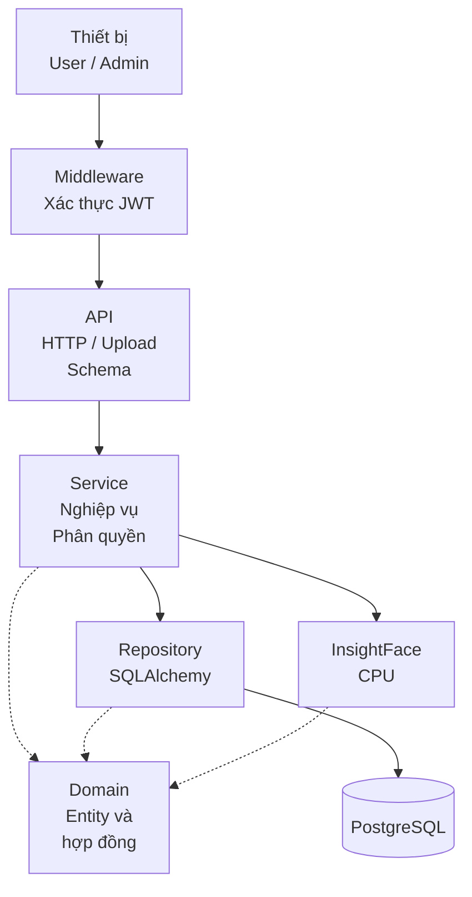

# Face Check-in Service - Hệ thống điểm danh bằng khuôn mặt


## 1. Đặc tả bài toán và mục tiêu

**Bài toán:** một đơn vị cần điểm danh ghi nhận sự có mặt của người đã đăng ký thông qua ảnh từ thiết bị điểm danh. Khi một người điểm danh, thiết bị gửi ảnh về hệ thống, hệ thống cần xác định danh tính, lưu thời điểm và kết quả tra cứu.

**Đầu vào:** thông tin tài khoản người dùng và ảnh chứa khuôn mặt.

**Đầu ra:** hồ sơ đã đăng ký, kết quả điểm danh gồm danh tính nếu khớp, thời điểm điểm danh, điểm tương đồng, ngưỡng và trạng thái, lịch sử được giới hạn theo quyền truy cập.

| Tác nhân | Chức năng và giới hạn quyền |
|---|---|
| Quản trị viên (`admin`) | Tạo/xóa tài khoản, xem toàn bộ user, hồ sơ mặt, lịch sử, xóa hồ sơ và bản ghi điểm danh |
| Người dùng (`user`) | Đăng nhập, đăng ký/xóa hồ sơ mặt của mình, xem thông tin và lịch sử cá nhân |
| Thiết bị điểm danh | Gửi ảnh đến API công khai, không gửi trước ID người cần nhận diện |

**Mục tiêu Phase 1:** xây dựng luồng nghiệp vụ hoàn chỉnh với kiến trúc phân tầng, đăng nhập/phân quyền, API có đặc tả, triển khai bằng Docker và baseline tải trên Kaggle CPU, phù hợp với các tiêu chí và yêu cầu đặt ra.

**Cơ sở cho Phase 2:** nhóm tiếp nhận chọn vấn đề ở mục 5, đề xuất cải tiến có lý do và kiểm chứng bằng benchmark.

## 2. Đặc tả nghiệp vụ và dữ liệu

**Luồng tạo tài khoản và đăng nhập:** Quản trị viên tạo tài khoản cho người dùng, hệ thống kiểm tra email và hash mật khẩu trước khi lưu. Người dùng đăng nhập để nhận JWT, sau đó gửi token kèm các yêu cầu cần xác thực. Hệ thống kiểm tra token và quyền truy cập trước khi xử lý.

**Luồng đăng ký khuôn mặt:** Người dùng đã đăng nhập gửi ảnh chứa khuôn mặt. Hệ thống kiểm tra ảnh, sinh và chuẩn hóa embedding vector rồi lưu thành hồ sơ thuộc tài khoản để đối chiếu khi điểm danh. Ảnh không hợp lệ, không có mặt hoặc có nhiều mặt sẽ bị từ chối.

**Luồng điểm danh và tra cứu:** Thiết bị gửi ảnh một khuôn mặt, hệ thống sinh embedding và tìm hồ sơ có điểm tương đồng cao nhất. Nếu đạt ngưỡng hệ thống lưu người khớp và kết quả điểm danh, nếu không khớp hoặc không có mặt, hệ thống vẫn lưu lịch sử thất bại. Người dùng xem lịch sử của mình, quản trị viên xem toàn bộ lịch sử.

| Tình huống | HTTP / trạng thái | Quy tắc lưu |
|---|---|---|
| Nhận diện đạt ngưỡng | `201` / `success` | Lưu user/profile khớp, thời điểm, điểm và ngưỡng |
| Không có hồ sơ phù hợp hoặc dưới ngưỡng | `404` / `unmatched` | Vẫn lưu lịch sử, lỗi trả `record_id` và `best_score` nếu có |
| Ảnh giải mã được nhưng không có mặt | `422` / `no_face` | Vẫn lưu lịch sử, lỗi trả `record_id` |
| Ảnh rỗng/hỏng, sai MIME hoặc quá dung lượng | `400` | Không tạo lịch sử |
| Nhiều mặt hoặc lỗi sinh embedding | `422` | Không tạo lịch sử |

Hệ thống gồm ba thực thể và không lưu ảnh gốc, chi tiết thiết kế trong [ERD](docs/erd.md).

| Thực thể | Dữ liệu chính và quan hệ |
|---|---|
| `User` | ID, email duy nhất, password hash, họ tên, vai trò, ngày tạo, một user có nhiều hồ sơ/lượt điểm danh |
| `FaceProfile` | ID, user sở hữu, embedding nhị phân `float32`, số chiều, tên model, ngày tạo |
| `CheckInRecord` | ID, thời gian UTC, trạng thái, điểm, ngưỡng tại lúc xử lý, user/profile khớp có thể null |

## 3. Kiến trúc và tổ chức mã nguồn

### Kiến trúc tổng quát

Hệ thống sử dụng kiến trúc phân tầng, tách phần tiếp nhận yêu cầu, xử lý nghiệp vụ, truy cập dữ liệu và nhận diện khuôn mặt.



| Thành phần | Trách nhiệm |
|---|---|
| API | Nhận yêu cầu, kiểm tra đầu vào và chuyển lỗi nghiệp vụ thành phản hồi HTTP |
| Service | Điều phối nghiệp vụ, kiểm tra quyền sở hữu và so khớp khuôn mặt |
| Domain | Định nghĩa dữ liệu, lỗi nghiệp vụ và hợp đồng truy cập dữ liệu, nhận diện |
| Repository | Truy cập database bằng SQLAlchemy, chuyển đổi dữ liệu ORM và domain |
| ML adapter | Phát hiện mặt và sinh embedding bằng InsightFace |

[Kiến trúc chi tiết](docs/architecture.md) trình bày các luồng xử lý và quyết định thiết kế.

### Tổ chức mã nguồn

```text
app/
├── main.py         # Khởi tạo FastAPI, middleware, router, handler lỗi
├── api/            # Route v1, JWT middleware, dependency, đọc upload
├── schemas/        # DTO: kiểm tra request và định dạng response
├── services/       # Use case user, face profile, check-in, phân quyền
├── domain/         # Entity, lỗi, hợp đồng Repository/FaceEmbedder
├── repositories/   # SQLAlchemy adapter và mapper ORM ↔ domain
├── models/         # ORM: User, FaceProfile, CheckInRecord
├── ml/             # InsightFace adapter sinh embedding
└── core/           # Cấu hình môi trường, password hash và JWT
alembic/            # Migration schema
scripts/            # Seed, benchmark, xuất OpenAPI
tests/              # Unit, API và integration test
docs/               # API JSON, ERD, kiến trúc, baseline, vận hành
.github/workflows/  # CI: quality gate, test và Docker/Compose
```


## 4. Đặc tả API

**Tệp đặc tả:** [docs/openapi.json](docs/openapi.json) theo chuẩn OpenAPI 3.1, gồm schema request/response và OAuth2. Bảng dưới mô tả các API chính, quy tắc, mã lỗi và kịch bản kiểm thử xem tại [API spec](docs/api-spec.md).

| Method / path | Mục đích và dữ liệu vào | Quyền |
|---|---|---|
| `POST /api/v1/auth/login` | OAuth2 form: `username` là email, `password`, trả access token | Công khai |
| `GET /api/v1/auth/me` | Thông tin user đang đăng nhập | Đăng nhập |
| `POST /api/v1/users` | JSON: `email`, `password`, `full_name`, `role` tùy chọn | Admin |
| `GET /api/v1/users/{user_id}` | Thông tin tài khoản theo ID | Chính user hoặc admin |
| `POST /api/v1/face-profiles` | Multipart field `image`, đăng ký cho user hiện hành | Đăng nhập |
| `GET /api/v1/face-profiles` | Danh sách hồ sơ, query `user_id` tùy chọn | User chỉ thấy của mình, admin được lọc toàn bộ |
| `DELETE /api/v1/face-profiles/{profile_id}` | Xóa hồ sơ mặt | Chủ hồ sơ hoặc admin |
| `POST /api/v1/checkins` | Multipart field `image`, nhận diện và ghi sự kiện | Công khai |
| `GET /api/v1/checkins` | Lọc `user_id`, `start`, `end`, `limit` | User chỉ thấy của mình, admin được lọc toàn bộ |
| `GET /api/v1/checkins/{record_id}` | Chi tiết sự kiện | User gắn với record hoặc admin |

## 5. Vấn đề Phase 1 và hướng cải tiến Phase 2

Baseline Phase 1 với Kaggle CPU 4 core, Uvicorn một worker, ngoài Compose. Notebook: [Face Check-in Benchmark trên Kaggle](https://www.kaggle.com/code/tphu25/face-checkin-benchmark). Kết quả đo `POST /api/v1/checkins` với PostgreSQL, chi tiết ở [tài liệu benchmark](docs/benchmark-phase1.md):

| Request đồng thời | Throughput (request/giây) | p95 (ms) | CPU toàn máy |
|---:|---:|---:|---:|
| 1 | 6,42 | 167,79 | 76,1% |
| 8 | 10,14 | 874,75 | 99,7% |

Khi tải tăng, CPU gần bão hòa và p95 tăng khoảng 5,2 lần. Cả 8.480 request đo trên SQLite/PostgreSQL không có lỗi HTTP. API tra cứu lịch sử đạt throughput cao nhất ở mức 2 request đồng thời: 142,43 req/s với SQLite và 124,41 req/s với PostgreSQL.

Các hướng cải tiến đề xuất cho Phase 2 (chi tiết tại [phân tích cải tiến](docs/phase-2-improvements.md)):

| Nội dung cần cải thiện | Hạn chế hiện tại | Hướng Phase 2 / cách đánh giá |
|---|---|---|
| **1. Hiệu năng xử lý điểm danh khi tăng tải** | Inference chạy bằng CPU trong cùng dịch vụ. Khi tăng từ 1 lên 8 request đồng thời, CPU đạt gần 100%, p95 tăng từ 167,79 lên 874,75 ms, trong khi throughput chỉ tăng từ 6,42 lên 10,14 request/giây. | Đo thời gian từng công đoạn, tối ưu số thread ONNX và worker, giới hạn inference đồng thời, đánh giá bằng throughput, p95/p99, CPU/RAM và tỷ lệ lỗi trên cùng cấu hình. |
| **2. Khả năng mở rộng khi số hồ sơ khuôn mặt tăng** | Mỗi request tải toàn bộ hồ sơ và tạo lại ma trận so khớp. Chi phí tăng theo số hồ sơ, trong khi baseline hiện chỉ đo với một hồ sơ. | Đo với 100/1.000/10.000 hồ sơ, lọc hồ sơ phù hợp ngay tại DB và thử cache ma trận embedding. Đo latency/RAM, kiểm tra cập nhật cache và độ đúng tìm kiếm, chỉ cân nhắc vector index khi matching là nút thắt đã được đo. |
| **3. Bảo mật cho API điểm danh** | API check-in công khai, chưa xác thực thiết bị, chưa có rate limit hoặc kiểm tra người thật, có rủi ro bị gửi ảnh giả và lạm dụng tài nguyên. | Bổ sung xác thực/thu hồi quyền thiết bị, giới hạn tần suất và đánh giá liveness, kiểm tra khả năng chặn truy cập trái phép, ảnh giả, tỷ lệ chặn nhầm và tác động đến độ trễ. |

## 6. Framework và tech stack

| Thành phần | Công nghệ | Vai trò/lý do sử dụng |
|---|---|---|
| Ngôn ngữ/runtime | Python 3.12, uv và `uv.lock` | Dùng chung hệ sinh thái web/ML, khóa dependency để tái lập môi trường |
| Web/API | FastAPI, Uvicorn, Pydantic | Routing, kiểm tra dữ liệu, dependency injection, sinh OpenAPI và Swagger UI |
| Dữ liệu | PostgreSQL 16 trong Compose, SQLAlchemy 2, psycopg | DB quan hệ có constraint/index, ORM hiện thực Repository, SQLite cho local/test nhanh |
| Migration | Alembic | Quản lý phiên bản schema, chạy migration trước ứng dụng |
| Nhận diện | InsightFace `buffalo_s`, ONNX Runtime CPU | Phát hiện mặt, sinh embedding bằng model có sẵn, không huấn luyện model riêng |
| Xử lý ảnh/vector | OpenCV, NumPy | Giải mã ảnh, chuẩn hóa vector và tính cosine bằng phép nhân ma trận |
| Bảo mật | PyJWT, OAuth2 Bearer, Argon2id | JWT cho request đã đăng nhập, băm mật khẩu, phân quyền admin/user và ownership |
| Đóng gói/chất lượng | Docker/Compose, pytest, Ruff, import-linter, GitHub Actions | Dựng môi trường, kiểm thử, kiểm tra style, ranh giới tầng và quy trình CI |

## 7. Chạy dự án và tài liệu bàn giao

Mã nguồn bàn giao nằm trên nhánh **`main`** của [GitHub](https://github.com/thanhphu25/face-checkin-service/tree/main).

```bash
git clone --branch main https://github.com/thanhphu25/face-checkin-service.git
cd face-checkin-service
git rev-parse HEAD
```

Build/chạy stack cần Git, Docker/Compose v2 và Internet để tải image/dependency/model khi chưa có cache. Sao chép `.env.example` thành `.env`, sinh `JWT_SECRET`, đặt `POSTGRES_PASSWORD` theo [hướng dẫn cấu hình](docs/running.md#clone-và-cấu-hình), rồi chạy từ thư mục gốc:

```bash
docker compose config --quiet
docker compose build
docker compose up -d --wait
docker compose logs migrate
```

- [Dockerfile](Dockerfile) đóng gói ứng dụng, [compose.yaml](compose.yaml) điều phối ba service `postgres`, `migrate` và `app`.
- [Migration Alembic](alembic/versions/) quản lý cấu trúc DB. Compose chờ PostgreSQL sẵn sàng, tự chạy `alembic upgrade head` rồi mới khởi động app. Lệnh `docker compose logs migrate` dùng để xem kết quả migration.
- [scripts/seed.py](scripts/seed.py) tạo tài khoản admin/user và dữ liệu mẫu, cần chạy riêng sau khi dựng stack theo [hướng dẫn seed](docs/running.md#seed-dữ-liệu-mẫu). Sau đó mở [Swagger UI](http://localhost:8000/docs) để đăng nhập và thử API.

Kiểm tra trong môi trường Python 3.12:

```bash
uv sync --python 3.12 --frozen --extra dev
JWT_SECRET=local-test-only uv run pytest -q
uv run ruff check .
uv run ruff format --check .
uv run lint-imports
```

Chi tiết bàn giao gồm mã nguồn, [migration](alembic/versions/), [seed](scripts/seed.py), [Dockerfile](Dockerfile), [Docker Compose](compose.yaml), [OpenAPI JSON](docs/openapi.json), [API spec](docs/api-spec.md), [ERD](docs/erd.md), [kiến trúc](docs/architecture.md), [baseline](docs/benchmark-phase1.md) và [hướng dẫn vận hành](docs/running.md).
