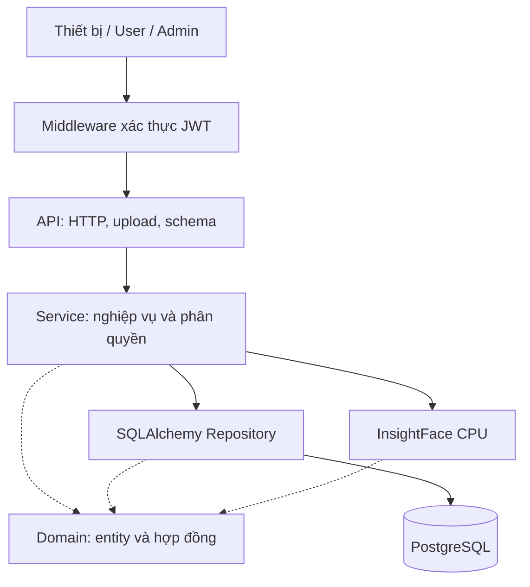
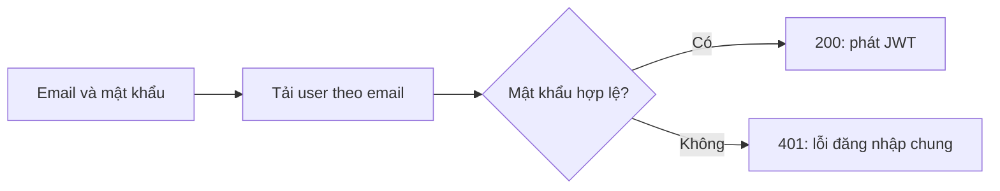
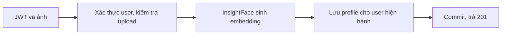
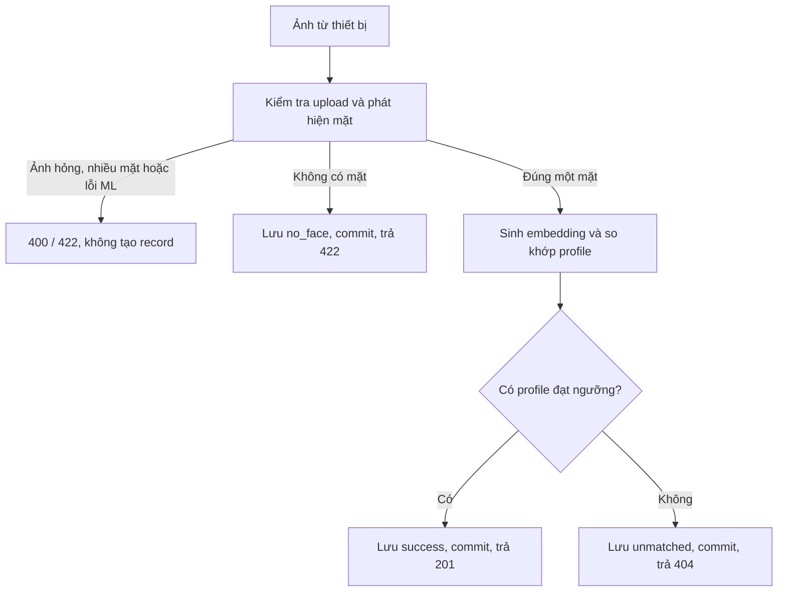
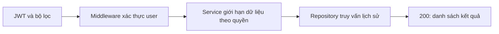

# Kiến trúc Face Check-in Service

Tài liệu mô tả kiến trúc, các luồng xử lý chính và các quyết định đã chấp nhận của backend điểm
danh bằng khuôn mặt. Hệ thống là một dịch vụ FastAPI, sử dụng PostgreSQL và InsightFace trên CPU.

## Kiến trúc tổng quát

Mũi tên liền thể hiện luồng gọi khi chạy, nét đứt thể hiện phụ thuộc vào hợp đồng Domain.
Middleware tải user bằng session đọc riêng và đóng trước khi endpoint xử lý nghiệp vụ.

| Thành phần | Trách nhiệm |
|---|---|
| API | Nhận yêu cầu, kiểm tra đầu vào và chuyển lỗi nghiệp vụ thành phản hồi HTTP |
| Service | Điều phối nghiệp vụ, kiểm tra quyền sở hữu và so khớp khuôn mặt |
| Domain | Định nghĩa dữ liệu, lỗi nghiệp vụ và hợp đồng truy cập dữ liệu, nhận diện |
| Repository | Truy cập database bằng SQLAlchemy, chuyển đổi dữ liệu ORM và domain |
| ML adapter | Phát hiện mặt và sinh embedding bằng InsightFace |

Service và Domain không phụ thuộc framework web hay thư viện database. Dependency tại API lắp
adapter vào Service và quản lý tài nguyên; import-linter kiểm tra ranh giới tầng trong CI.

## Các luồng xử lý chính

Các endpoint nghiệp vụ dưới đây có tiền tố /api/v1. User thường thao tác trên dữ liệu của mình;
admin có quyền quản trị theo [đặc tả API](api-spec.md).

### Đăng nhập

API nhận email/mật khẩu, Service chuẩn hóa email, tải user và kiểm tra password hash. Credential
hợp lệ trả access token; email không tồn tại và mật khẩu sai cùng trả 401 với thông điệp chung.
Ở request tiếp theo, middleware xác minh JWT và tải lại user; dependency sử dụng principal đó,
không decode token hoặc truy vấn user lần nữa.

### Đăng ký khuôn mặt

Sau xác thực, API kiểm tra upload JPEG/PNG theo giới hạn cấu hình. Service kiểm tra user còn tồn
tại, gọi InsightFace và lưu vector đã chuẩn hóa cùng model/dimension. Profile luôn thuộc user
đang đăng nhập; response 201 không chứa vector. Không có mặt, nhiều mặt hoặc lỗi ảnh/embedding
đều từ chối đăng ký và không tạo profile.

### Điểm danh

Endpoint này công khai, không yêu cầu JWT. Ảnh có đúng một mặt được chuyển thành embedding;
Service tải profile, lọc cùng model/dimension rồi chọn cosine score cao nhất. Ngưỡng so khớp được
lưu cùng record để giải thích lịch sử khi cấu hình thay đổi.

Success trả danh tính khớp; unmatched/no_face trả record_id để tra cứu lần điểm danh thất bại.
Không có mặt là kết quả nghiệp vụ được lưu; ảnh hỏng, nhiều mặt hoặc lỗi embedding không tạo record.

Dependency commit cả lỗi domain để giữ audit của unmatched/no_face trước khi trả lỗi HTTP;
lỗi hệ thống rollback. Nếu client chủ động gửi Bearer token không hợp lệ, middleware trả 401
trước khi đi vào luồng điểm danh, dù endpoint công khai.

### Tra cứu và quản lý dữ liệu

Middleware xác thực user; Service ép phạm vi truy vấn của user thường về chính họ, kể cả khi
truyền bộ lọc user khác. Admin được xem và lọc toàn hệ thống. History hỗ trợ bộ lọc thời gian,
limit và thứ tự mới nhất trước; GET chi tiết kiểm tra quyền sở hữu và trả 403 nếu không đủ quyền.

Khi xóa, admin quản lý user/check-in; admin hoặc chủ sở hữu được xóa profile. Repository thực hiện
thay đổi trong transaction của request. Xóa user kéo theo profile nhưng vẫn giữ lịch sử điểm
danh, các liên kết tới user/profile đã xóa được đặt rỗng.

## Quyết định thiết kế

### Database

**Lựa chọn:** PostgreSQL cho triển khai thực tế, SQLite cho local và test nhanh. Alembic quản lý
schema. Session nghiệp vụ theo request; Repository chỉ flush, dependency commit hoặc rollback.
Lỗi domain vẫn commit để giữ lịch sử điểm danh thất bại; lỗi hệ thống rollback.

**Lý do và đánh đổi:** Repository tách database khỏi nghiệp vụ nhưng phải kiểm tra mapping và
ràng buộc trên cả hai backend. Thời gian chuẩn hóa UTC; lịch sử được giữ khi xóa user/profile,
các liên kết tương ứng thành rỗng. Hồ sơ khuôn mặt bị xóa theo user.

**Khi cần xem lại:** nghiệp vụ ghi nhiều bảng cần tính nguyên tử thì đánh giá Unit of Work và
ranh giới transaction tại use case; đổi database phải kiểm tra lại migration và ràng buộc.

### Auth

**Lựa chọn:** middleware xác minh JWT và tải user hiện hành một lần mỗi request; role trong DB
quyết định quyền. Service kiểm tra ownership, OAuth2PasswordBearer khai báo bảo mật cho Swagger.
Mật khẩu mới dùng Argon2id; PBKDF2 chỉ để xác minh dữ liệu cũ.

**Lý do và đánh đổi:** xác thực tập trung tránh xử lý lặp. Session xác thực tách khỏi session nghiệp
vụ; mỗi request có token cần truy vấn user nên việc đổi role hoặc xóa user có hiệu lực ngay ở lần
gọi tiếp theo. Thiếu token vẫn gọi được API công khai; Bearer token sai bị trả 401 trên mọi route.

**Khi cần xem lại:** cần refresh token, logout/revoke tức thời hoặc SSO. Hiện chưa có cơ chế thu hồi
token riêng; bỏ hỗ trợ PBKDF2 sau khi chuyển hết hash cũ.

### Embedding

**Lựa chọn:** InsightFace buffalo_s chạy CPU, model được tạo khi cần và tái sử dụng trong process.
Embedding float32, L2-normalized, lưu dạng bytes kèm model và dimension. Service chỉ so khớp hồ sơ
cùng model/dimension, chọn cosine score cao nhất đạt ngưỡng mặc định 0.40; lưu ngưỡng cùng record.

**Lý do và đánh đổi:** phù hợp máy dev/Kaggle, lưu trữ gọn và giữ matching độc lập với DB. Tuy nhiên,
chi phí tải và quét hồ sơ tăng theo dữ liệu; ngưỡng hiện tại chưa được đánh giá trên tập ảnh thực tế.

**Khi cần xem lại:** tốc độ hoặc độ chính xác không đạt yêu cầu. Đổi model cần tạo lại embedding
hoặc tách hồ sơ theo model; không trộn vector khác model dù cùng dimension.

### Infrastructure

**Lựa chọn:** Compose gồm app, migrate và postgres; app chờ migration thành công. Database và
model cache có volume riêng. Chưa dùng Redis, pgvector, FAISS hoặc async database.

Dockerfile dùng Python 3.12 slim qua hai giai đoạn. `builder` cài dependency từ `uv.lock` bằng
`uv sync --frozen` và cài ứng dụng vào `.venv`; tách bước copy dependency/code để tận dụng cache.
`runtime` nhận môi trường đã cài, code và Alembic, thêm thư viện hệ thống cho xử lý ảnh, rồi chạy
Uvicorn một worker bằng user `app` UID 10001. Ảnh mẫu và dữ liệu phụ được loại khỏi image cuối;
seed/test chạy từ môi trường Python/uv trên host.

Compose truyền cấu hình từ `.env` qua các biến được khai báo, tạo connection URL dùng hostname
`postgres` trong mạng container. Host truy cập qua các cổng publish. Volume `postgres_data`
mount vào `/var/lib/postgresql/data`, còn `insightface_models` mount vào `/home/app/.insightface`;
thay container vẫn giữ dữ liệu nếu chưa xóa volume.

Model được tải khi dependency embedder khởi tạo và chưa có cache. Cache host dùng khi seed tách
khỏi cache container; mỗi tiến trình giữ một bản model trong RAM. Dependency dùng chung khiến
GET/DELETE face-profile/check-in cũng có thể kích hoạt tải/nạp model. Health hiện chỉ kiểm tra
handler HTTP; kiểm tra model và luồng nhận diện là bước xác minh riêng sau khi dựng stack.

**Lý do và đánh đổi:** giữ triển khai đơn giản, tránh chi phí cache/index khi chưa có số đo chứng
minh nhu cầu. Migration chạy một lần trước app để tránh các replica cùng nâng schema.
Khóa dependency giúp tái lập package; build hai giai đoạn và loại dữ liệu phụ giảm thành phần
trong image chạy. Base image hiện chưa khóa theo digest, nên không bảo đảm image giống hệt ở mọi
lần build. Tải model lúc dùng giúp tách model khỏi image nhưng tạo độ trễ lần đầu và yêu cầu
Internet khi cache trống. Cách build, chuẩn bị model và xử lý lỗi nằm ở [hướng dẫn vận hành](running.md#4-chạy-từ-máy-sạch-bằng-docker-compose).

**Khi cần xem lại:** có nhu cầu mở rộng hoặc phép đo chứng minh lợi ích. Hạ tầng mới cần đi cùng
kiểm thử hành vi lỗi, tính nhất quán và benchmark trước/sau.

### Benchmark

**Lựa chọn:** đo trên Kaggle CPU, Uvicorn một worker ngoài Compose; tách tải điểm danh và đọc lịch
sử, đo cả SQLite/PostgreSQL. Percentile dùng nearest-rank; warm-up tách khỏi số liệu và có khoảng
lặng trước khi đo CPU. Kết quả lưu CSV kèm metadata.

**Lý do và đánh đổi:** Kaggle notebook không chạy Docker; kết quả chỉ đại diện cấu hình đã đo.
Baseline có một profile nên chưa phản ánh dữ liệu lớn và không chứng minh độ chính xác nhận diện.

**Khi cần xem lại:** đổi phần cứng, dữ liệu, workload hoặc tham số phải đo lại baseline tương ứng.
CI kiểm tra unit/API/integration, phân tầng, Docker và Compose; test model thật chạy riêng.

Chi tiết: [ERD](erd.md), [API](api-spec.md), [cách chạy](running.md),
[kết quả baseline](benchmark-phase1.md), [cách đo](benchmark-phase1.md#7-chạy-lại-trên-kaggle-cpu),
[hướng cải tiến](phase-2-improvements.md).
