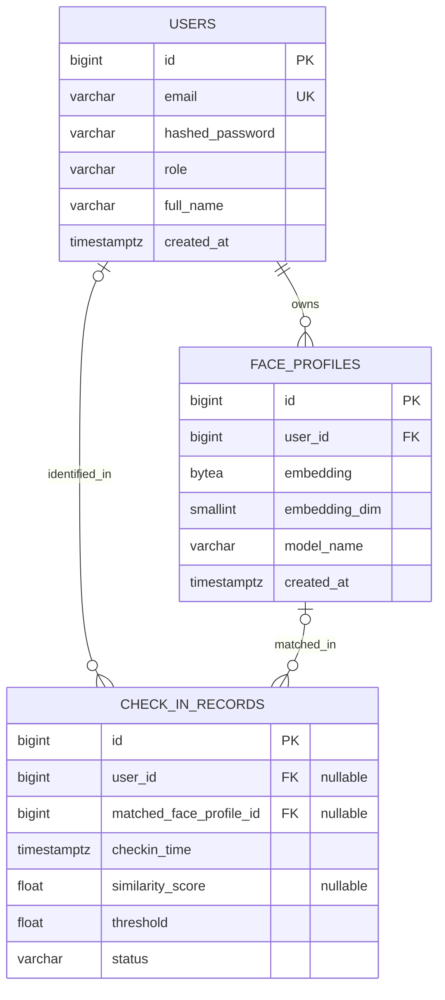

# Mô hình dữ liệu

Schema gồm ba bảng, quản lý bởi Alembic qua migration 0001 và 0002.
[Kiến trúc](architecture.md) giải thích phân tầng; [API spec](api-spec.md) mô tả response và quyền.

## 1. Sơ đồ quan hệ

Một user có nhiều profile và lượt điểm danh. Một record có thể không gắn user/profile nếu không
nhận diện được hoặc danh tính/hồ sơ đã bị xóa. Diagram dùng kiểu PostgreSQL; SQLite dùng kiểu
nhị phân và khóa chính tương ứng.

## 2. User

| Field | Quy tắc |
|---|---|
| id | Khóa chính tự sinh |
| email | Tối đa 255 ký tự, duy nhất; ứng dụng trim và chuẩn hóa chữ thường |
| hashed_password | Hash Argon2id; hỗ trợ verify PBKDF2 cũ, không lưu mật khẩu gốc |
| role | Chỉ admin hoặc user, có CHECK constraint |
| full_name | Tối đa 255 ký tự, bắt buộc |
| created_at | Thời điểm tạo, chuẩn hóa UTC |

Email có unique constraint; kiểm tra trùng ở Service không thay thế ràng buộc DB khi có ghi đồng
thời. API không trả password hash.

## 3. Face profile và embedding

| Field | Quy tắc |
|---|---|
| id, user_id | Khóa chính và chủ sở hữu bắt buộc; xóa user sẽ xóa profile theo CASCADE |
| embedding | Bytes little-endian float32, vector hữu hạn và chuẩn hóa L2 |
| embedding_dim | Số chiều, CHECK lớn hơn 0; Repository kiểm tra khớp số phần tử |
| model_name | Model sinh vector; hiện dùng buffalo_s, thông thường 512 chiều |
| created_at | Thời điểm đăng ký UTC |

Một vector 512 chiều chiếm 2.048 byte, không tính overhead của row. PostgreSQL lưu BYTEA, SQLite
lưu BLOB. Bytes gọn hơn JSON; database chưa làm vector search. Model/dimension phải khớp trước
khi so sánh; không trộn vector khác model dù cùng dimension.

Index theo user_id phục vụ lọc profile và kiểm tra dữ liệu chủ sở hữu. Repository chuyển bytes
thành bản copy mảng NumPy; API chỉ trả metadata profile, không trả embedding hoặc lưu ảnh gốc.

## 4. Check-in record

| Field | Quy tắc |
|---|---|
| id | Khóa chính tự sinh |
| user_id, matched_face_profile_id | Liên kết có thể null; xóa đối tượng liên quan thì SET NULL |
| checkin_time | Thời điểm điểm danh UTC |
| similarity_score | Có thể null khi không có mặt hoặc không có profile phù hợp |
| threshold | Ngưỡng tại thời điểm xử lý, luôn lưu để giải thích lịch sử |
| status | success, unmatched hoặc no_face; có CHECK constraint |

Success cần score khác null theo constraint hiện tại. User/profile có thể null sau khi bị xóa;
migration 0002 bỏ điều kiện bắt buộc user trên record success để giữ được lịch sử.
Unmatched lưu score tốt nhất nếu có, no_face không có score. Hành vi HTTP tương ứng được mô tả
trong [luồng điểm danh](architecture.md) và [API spec](api-spec.md).

Hai index phục vụ lịch sử: kết hợp user_id/checkin_time cho truy vấn theo người và checkin_time
cho truy vấn toàn hệ thống. Repository sắp xếp thời gian giảm dần, rồi ID giảm dần.

## 5. Quy ước persistence và kiểm chứng

- SQLAlchemy ánh xạ khóa chính BIGINT của PostgreSQL sang INTEGER của SQLite; dữ liệu nhị phân
  dùng LargeBinary và thời gian được chuẩn hóa UTC khi chuyển ORM sang domain.
- SQLite phải bật foreign_keys cho từng connection để CASCADE/SET NULL có hiệu lực.
- Alembic quản lý tạo/nâng schema và tên constraint; không dựng bảng tự động khi app khởi động.
- Repository chỉ flush; dependency quản lý commit/rollback theo [quyết định transaction](architecture.md#database).
- Integration test chạy migration và kiểm tra CRUD, bytes embedding, filter, unique email và
  hành vi xóa trên cả SQLite/PostgreSQL. Upgrade/downgrade chỉ thử trên database cách ly.

Seed tạo hai tài khoản admin/user, một profile và ba record mẫu; tùy chọn bỏ profile dùng để
thử đăng ký qua Swagger. Cách chạy, mật khẩu do người chạy cung cấp và dọn dữ liệu nằm trong
[hướng dẫn vận hành](running.md). Không lưu ảnh mặt, database hay embedding thật vào Git.

Nguồn schema: [ORM models](../app/models/), [migration](../alembic/versions/),
[repository và mapper](../app/repositories/).
