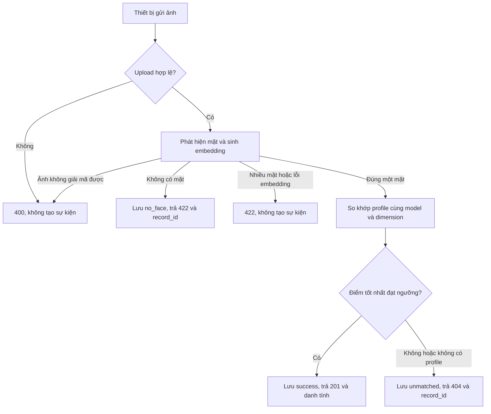
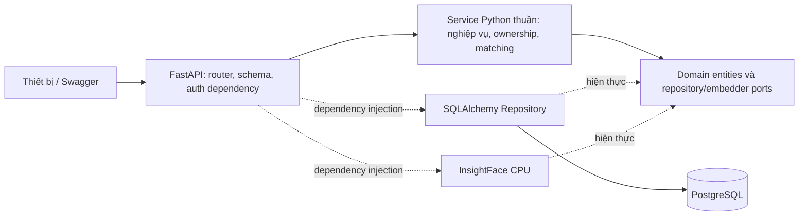

# Nội dung review Pha 1 — Face Check-in Service

Tài liệu chuẩn bị theo yêu cầu: mô tả bài toán và nghiệp vụ cơ bản; đặc tả API; trình bày baseline
để phân tích và cải tiến kiến trúc ở Pha 2. Đối chiếu source tại commit `82ddeb6`; số liệu benchmark
đã có được đo tại commit `4affbd0` ngày 2026-09-22. Đây là hai mốc khác nhau, cần giữ riêng khi
trình bày. Tài liệu không ấn định ngày họp vì thông báo chưa có lịch cụ thể.

## 1. Bài toán được chọn

**Xây dựng dịch vụ backend ghi nhận điểm danh bằng khuôn mặt.** Tại một điểm điểm danh, thiết bị
gửi ảnh của một người tới backend. Backend tìm người tương ứng trong tập hồ sơ đã đăng ký, ghi
thời điểm và kết quả để người dùng hoặc quản trị viên xem lại.

Ví dụ nghiệp vụ: quản trị viên tạo tài khoản cho Nguyễn Văn A; A đăng nhập và đăng ký ảnh khuôn
mặt; thiết bị gửi ảnh A tới API điểm danh; hệ thống trả danh tính khớp và ghi lịch sử. Nếu ảnh
không có mặt hoặc không khớp ai, hệ thống vẫn lưu sự kiện tương ứng để quản trị viên kiểm tra.

Đối tượng sử dụng:

| Tác nhân | Nhu cầu và quyền chính |
|---|---|
| Quản trị viên (`admin`) | Tạo/xóa tài khoản; xem hồ sơ và lịch sử toàn hệ thống; xóa bản ghi |
| Người dùng (`user`) | Đăng nhập; đăng ký/xóa hồ sơ của mình; xem thông tin và lịch sử của mình |
| Thiết bị điểm danh | Gửi một ảnh JPEG/PNG tới API điểm danh công khai |

Pha 1 cung cấp các chức năng backend cơ bản. Chưa có giao diện camera, quản lý lớp/ca làm, tính
lương, xác định đi muộn, check-out, chống điểm danh trùng trong ngày hay xử lý điểm danh offline.
Vì vậy, mỗi request hợp lệ là một lần ghi nhận sự kiện; không đồng nghĩa một ngày công hợp lệ.

## 2. Nghiệp vụ và quy tắc

| Mã | Nghiệp vụ | Điều kiện và kết quả |
|---|---|---|
| NV01 | Quản lý tài khoản | Admin tạo tài khoản bằng email, tên, mật khẩu và role; email chuẩn hóa và duy nhất; mật khẩu lưu dưới dạng hash |
| NV02 | Đăng nhập | Email/mật khẩu hợp lệ trả access token; sai thông tin trả `401`; các API được bảo vệ dùng Bearer token |
| NV03 | Đăng ký khuôn mặt | Người đã đăng nhập gửi ảnh có đúng một mặt; profile luôn thuộc người gọi; một user được có nhiều profile |
| NV04 | Điểm danh | Ảnh có đúng một mặt được chuyển thành embedding và tìm profile có cosine similarity cao nhất |
| NV05 | Tra cứu | Admin xem toàn bộ và lọc theo user; user thường luôn được giới hạn vào dữ liệu của mình |
| NV06 | Xóa dữ liệu | Admin xóa user/check-in; admin hoặc chủ sở hữu xóa profile; lịch sử được giữ khi xóa user/profile, các liên kết tương ứng thành `null` |

Quy tắc nhận diện của baseline:

1. Chấp nhận upload có MIME `image/jpeg` hoặc `image/png`, tối đa 5 MiB theo cấu hình mặc định;
   ảnh phải giải mã được.
2. InsightFace `buffalo_s` chạy CPU, phát hiện mặt và sinh embedding được chuẩn hóa L2.
3. Chỉ so sánh với profile có cùng model và dimension; baseline tải toàn bộ profile trước khi lọc.
4. Điểm cao nhất **lớn hơn hoặc bằng** ngưỡng cấu hình (`0.40` mặc định) là `success`.
5. Không có profile phù hợp hoặc điểm dưới ngưỡng: lưu `unmatched`, trả HTTP `404` kèm `record_id`.
6. Không có mặt: lưu `no_face`, trả HTTP `422` kèm `record_id`.
7. Ảnh hỏng, nhiều mặt hoặc lỗi embedding bị từ chối; các nhánh này chưa tạo bản ghi điểm danh.
8. Lưu ngưỡng cùng sự kiện để giải thích được lịch sử khi cấu hình ngưỡng thay đổi.

`0.40` là giá trị cấu hình baseline, chưa phải ngưỡng đã được đánh giá độ chính xác trên tập ảnh
thực tế của bài toán. Kết quả benchmark hiệu năng không chứng minh độ chính xác nhận diện.

## 3. Dữ liệu và API

| Thực thể | Thông tin chính | Quan hệ |
|---|---|---|
| `User` | Email, password hash, họ tên, role, thời điểm tạo | Một user có nhiều face profile và check-in |
| `FaceProfile` | Chủ sở hữu, embedding bytes float32, dimension, model, thời điểm tạo | Thuộc một user; xóa user sẽ xóa profile |
| `CheckInRecord` | Thời điểm UTC, status, similarity, threshold, user/profile khớp nếu có | Giữ lịch sử khi user/profile bị xóa |

Baseline lưu embedding, không lưu ảnh upload gốc trong các bảng này. Response không trả password
hash hoặc embedding. Xem [ERD](erd.md) để biết cấu trúc và ràng buộc chi tiết.

Có **14 thao tác HTTP trên 9 path**: health, đăng nhập/thông tin hiện hành, quản lý user, đăng ký
và quản lý profile, tạo/tra cứu/xóa check-in. Request quản lý user dùng JSON; đăng nhập dùng OAuth2
form; upload ảnh dùng multipart; response dữ liệu dùng JSON.

[Đặc tả API](api-spec.md) ghi method/path, quyền, request, response, mã lỗi và ví dụ.
[OpenAPI tĩnh](openapi.json) và Swagger `/docs` là contract máy đọc được. Các API đại diện đáp ứng
yêu cầu xác thực gồm `GET /api/v1/auth/me` và `POST /api/v1/face-profiles`.

## 4. Baseline kiến trúc Pha 1

Một dịch vụ backend phân tầng, triển khai trong một app container. Service không import framework
web hay thư viện DB; Repository chuyển giữa ORM và domain. Alembic quản lý schema; session
commit/rollback theo request, riêng domain error được commit để giữ audit `unmatched`/`no_face`.
Xác thực dùng dependency chung, quyền sở hữu kiểm tra tại Service.

Compose có app, PostgreSQL, migration và Redis. **Redis chưa được application sử dụng**.
Baseline dùng truy vấn SQLAlchemy đồng bộ, matching toàn bộ profile, không cache embedding hay
vector index. Benchmark đã có dùng Uvicorn một worker ngoài Compose; cấu hình đó phải được ghi
rõ khi so sánh hiệu năng. Xem [kiến trúc](architecture.md) và [ADR](adr/).

## 5. Bằng chứng baseline và giới hạn

Số liệu đã lưu trong repo, không phải lượt đo mới trong lần chuẩn bị tài liệu này:
[CSV PostgreSQL](benchmark/baseline-postgresql.csv),
[metadata PostgreSQL](benchmark/baseline-postgresql.metadata.json),
[báo cáo đầy đủ](benchmark-phase1.md).

Điều kiện: Kaggle CPU 4 core, một worker, model `buffalo_s`; concurrency 1/2/4/8; warm-up 5;
60 request/mức cho check-in, 1.000 request/mức cho history. Cả 16 mức đo của hai backend có
`error_count = 0` trong các scenario thành công được đo.

| Scenario PostgreSQL | c=1 | c=2 | c=4 | c=8 |
|---|---:|---:|---:|---:|
| Check-in throughput (req/s) | 4.83 | 6.63 | 7.17 | 8.46 |
| Check-in p95 (ms) | 227.7 | 350.4 | 734.0 | 1116.0 |
| History throughput (req/s) | 139.1 | 168.7 | 157.0 | 150.3 |
| History p95 (ms) | 7.8 | 13.2 | 32.0 | 73.5 |

Giới hạn: chỉ một face profile, bảng lịch sử khoảng 260 bản ghi, mỗi cấu hình đo một lần,
chưa có tải hỗn hợp đọc/ghi và chưa đánh giá false accept/false reject. Số liệu hiện có không
đại diện cho hàng nghìn người hay hiệu năng triển khai Compose. CPU tổng gần bão hòa khi tải
check-in tăng là dấu hiệu nút thắt CPU; cần đo từng công đoạn để xác định tỷ trọng inference,
matching và DB trước khi chọn cải tiến.

## 6. Phân tích vấn đề cho Pha 2

Các phương án dưới đây là đề xuất thí nghiệm, chưa triển khai hoặc khẳng định cải thiện. Nhóm
nhận hệ thống cần đo lại baseline trên cùng phần cứng rồi chọn 2–3 cải tiến có bằng chứng.

| Vấn đề / mức bằng chứng | Thuộc tính chất lượng | Thí nghiệm kiến trúc đề xuất | Cách đánh giá và đánh đổi |
|---|---|---|---|
| Check-in tăng p95 từ 227.7 lên 1116.0 ms khi c tăng 1→8; CPU gần bão hòa — đã đo | Hiệu năng, khả năng đáp ứng | Đo thời gian decode/detection/embedding/matching/DB; thử phối hợp số worker và số thread inference có giới hạn | So sánh throughput/p95/p99, CPU/RAM; nhiều worker nhân bản model và có thể tranh CPU, không mặc định nhanh hơn |
| History ở c=8 còn CPU rảnh; nguyên nhân cụ thể chưa xác định | Hiệu năng đọc, khả năng mở rộng | Profile thread pool, thời gian chờ connection/query; thử multi-worker hoặc async I/O nếu xác nhận chờ I/O | Giữ SQL, dữ liệu và tải như nhau; đo p95/throughput và connection count; tăng worker có chi phí RAM/connection |
| Mỗi check-in tải và so khớp toàn bộ profile — thấy trong code, chưa đo ở tập lớn | Khả năng mở rộng theo dữ liệu | Đo với 100/1.000/10.000 profile; thử cache ma trận embedding hoặc vector index khi matching chiếm tỷ trọng lớn | Đo thời gian matching, RAM và recall so với exact search; cache cần invalidation khi thêm/xóa profile; ANN có thể đổi kết quả |
| Đường inference và history chung process; ảnh hưởng lẫn nhau chưa đo | Tính cô lập, khả năng đáp ứng | Đo tải hỗn hợp; thử tách inference thành worker/service nếu history bị ảnh hưởng rõ | Đo p95 history dưới tải inference, lỗi và recovery; thêm network hop, vận hành và cơ chế backpressure |
| API điểm danh công khai, chưa có liveness hoặc xác thực thiết bị — thấy trong code | Bảo mật, tính đúng đắn nghiệp vụ | Nếu bối cảnh triển khai yêu cầu: thêm xác thực thiết bị/rate limit; đánh giá liveness như một bước của pipeline | Test thiết bị hợp lệ/không hợp lệ, quá tải và ảnh giả; bổ sung latency và thay đổi contract cho client |

Không lấy việc SQLite chậm hơn ở tải đọc làm lý do duy nhất để thay DB: baseline triển khai đã
dùng PostgreSQL. Tương tự, cache DB không tự giải quyết chi phí inference trên CPU.

Quy trình so sánh trước/sau:

1. Chốt workload và mục tiêu cùng nhóm: ưu tiên p95 điểm danh hay throughput đọc; xác định số
   người, lượng request và tỷ lệ đọc/ghi cần hỗ trợ. Chưa có SLO chính thức từ yêu cầu hiện tại.
2. Đo lại baseline và phương án trên cùng phiên/cấu hình Kaggle CPU, cùng model, ảnh, số profile,
   dữ liệu lịch sử, threshold và tham số tải; ghi commit và metadata cho từng lần.
3. Chạy mỗi cấu hình ít nhất ba lần sau warm-up; trình bày trung vị và khoảng dao động. Thay đổi
   một yếu tố mỗi thí nghiệm để biết cải tiến đến từ đâu.
4. Giữ bộ đo cũ để so sánh trực tiếp; bổ sung tải hỗn hợp/tập profile lớn thành bộ đo riêng và
   chạy cả baseline lẫn phương án trên bộ mới.
5. Chạy lại kiểm tra JWT/ownership, matching tại ngưỡng, audit khi thất bại và lịch sử sau xóa.
   Nếu dùng ANN/liveness, đo thêm tác động tới kết quả nhận diện.
6. Chấp nhận phương án khi đáp ứng mục tiêu đã thống nhất, cải thiện vượt dao động đo và không
   làm sai nghiệp vụ. Ghi ADR kèm chi phí CPU/RAM, độ phức tạp và phương án phục hồi.

## 7. Kịch bản trình bày online — khoảng 10 phút

| Thời lượng | Nội dung | Minh chứng mở trên màn hình |
|---|---|---|
| 0–2 phút | Bài toán, ba tác nhân, ví dụ A đăng ký rồi điểm danh | Mục 1–2 và sơ đồ luồng |
| 2–4 phút | API, định dạng request, quyền và lỗi nghiệp vụ | `api-spec.md` và Swagger |
| 4–7 phút | Demo đăng nhập → đăng ký → điểm danh → lịch sử; một nhánh thất bại | Swagger với database demo riêng |
| 7–8 phút | Baseline phân tầng, PostgreSQL, inference CPU | Mục 4 và ERD |
| 8–10 phút | Số liệu, giới hạn và thí nghiệm Pha 2 | Mục 5–6, CSV và metadata |

Luồng demo cụ thể (không giả định ID do database cấp):

1. Dựng stack và seed theo [README](../README.md); dùng ảnh và tài khoản mẫu cho buổi demo.
2. Đăng nhập admin, lưu token; gọi `GET /auth/me`, `GET /users` và tạo user nếu cần minh họa.
3. Đăng nhập user, Authorize trong Swagger; gửi ảnh đúng một mặt tới `POST /face-profiles`.
4. Gọi API điểm danh công khai với cùng ảnh; kiểm tra `201`, `success` và ID user khớp.
5. Dùng token user xem `GET /checkins`; bỏ token để minh họa `401` trên API đọc.
6. Gửi ảnh không có mặt: nhận `422` và `record_id`; admin đọc record đó và thấy `no_face`.
7. Nếu cần minh họa `unmatched`, dùng ảnh của người chưa đăng ký; admin kiểm tra bản ghi `404`
   trả về. User thường không thấy sự kiện không gắn danh tính.

Các path trên dùng tiền tố `/api/v1`. Chuẩn bị trước model cache và ảnh demo để không phải chờ
tải model trong buổi họp. Hướng dẫn thao tác chi tiết: [test Swagger](swagger-api-testing.md).

## 8. Việc chuẩn bị trước buổi họp

- [x] Mô tả bài toán, tác nhân, phạm vi và quy tắc nghiệp vụ trong tài liệu này.
- [x] Đặc tả request/response/quyền/mã lỗi tại [api-spec.md](api-spec.md).
- [x] Tổng hợp kiến trúc baseline và số liệu đã có, ghi rõ điều kiện và giới hạn đo.
- [x] Có bảng vấn đề, thí nghiệm Pha 2 và quy trình đánh giá trước/sau.
- [ ] Nhóm chốt lịch online, người trình bày và người vận hành demo.
- [ ] Chạy thử luồng demo trên môi trường sẽ dùng để chia sẻ màn hình.
- [ ] Chốt quy mô người dùng, mức tải và mục tiêu chất lượng sau khi review.

Các mục chưa tick là hoạt động buổi họp/demo thực tế, không được xem là đã hoàn tất chỉ vì tài
liệu và code đã có.
